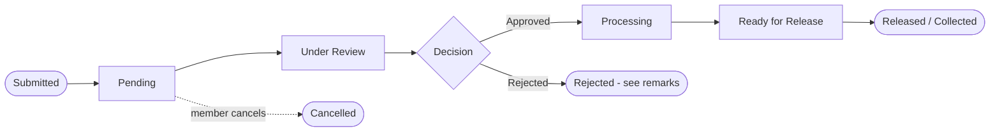

<div align="center">


# BAI Passport Tracking System

**A human-centered way to apply for, renew, and track a passport — and to get help along the way.**

[](#-hci-design-principles-in-practice)
[](#-prototype-limitations)
[](#-tech-stack)

[**Live Demo**](https://bainary-empire.github.io) · [**Features**](#-features) · [**HCI Principles**](#-hci-design-principles-in-practice) · [**Getting Started**](#-getting-started) · [**Project Structure**](#-project-structure)

<br>


</div>

---

## 📖 About the Project

The **BAI Passport Tracking System** is a website built by **Team Bainary Empire** for our **Human–Computer Interaction (HCI)** course. It is set in the world of **Bisaya Airlines International (BAI)** and shows how a passport service could feel clear and calm instead of confusing and stressful.

Applying for a passport usually means unfamiliar forms, long document lists, and a lot of waiting without knowing what is going on. This project tackles those pain points directly:

| The problem | Our design response |
|---|---|
| *"What do I need to submit?"* | Step-by-step wizards that ask for only what applies to you, with links to the Knowledge Base at the point of need. |
| *"Did I fill this out correctly?"* | Prefilled account data, dropdowns instead of free text, and inline error messages next to the field that needs attention. |
| *"Where is my application?"* | A live status timeline and notifications, so progress is never a mystery. |
| *"Who do I ask?"* | A searchable Knowledge Base, an AI Assistant, and a formal enquiry channel with real-time replies. |

> [!NOTE]
> This is an **academic prototype**. It is **not** an official Philippine Department of Foreign Affairs (DFA) service and is not connected to any real government system. Please use fictional data only.

---

## 🧭 One Project, Three Portals

The system is made of three separate front ends, each designed for a different kind of user.

| Portal | Path | Who it is for | What it does |
|---|---|---|---|
| 🧑‍✈️ **MyBAI Member Website** | [`/`](index.html) | Passport applicants | Create an account, apply, renew, track status, and get support. |
| 🎧 **Personnel Portal** | [`/personnel/`](personnel/index.html) | Support personnel | Answer enquiries and manage the Knowledge Base. |
| 🛡️ **Admin Portal** | [`/admin/`](admin/index.html) | Administrators | Manage personnel accounts and review renewal and new-passport applications. |

The Personnel and Admin portals are intentionally **not linked** from the member website.

---

## ✨ Features

Open any section to see what is inside.

<details open>
<summary><b>🔐 Accounts and secure access</b></summary>

<br>

- Separate **adult** and **minor (guardian)** registration flows.
- Passwordless sign-in with an **email One-Time Password (OTP)** and a resend cooldown timer.
- Profile page, settings, and an OTP-protected **change email** flow.
- Linked **Terms & Conditions** and **Privacy Policy** pages.

</details>

<details open>
<summary><b>🛂 Passport services</b></summary>

<br>

- **Apply for a New Passport**: a five-step wizard.
  1. Applicant & Documents
  2. Personal & Family Details
  3. Contact & Emergency
  4. Oath
  5. Fee & Review

  Adults upload a PSA Birth Certificate and a valid ID. Minors upload a birth certificate plus a Parent / Guardian Consent and the guardian's ID.
- **Passport Renewal**: the same five-step pattern, driven by a **renewal-reason dropdown** (expiring, damaged, lost, or citizen status changed). The reason decides which supporting document is requested and whether a penalty applies.
- **Lost Passport Replacement** form.
- **Link Passport Application** using a 17-digit DFA Appointment Reference Number (ARN).
- Regular or Express processing, optional courier delivery, and a **live fee estimate**.
- One active application at a time, with clear messaging when a second one is attempted.

</details>

<details open>
<summary><b>📍 Tracking and notifications</b></summary>

<br>

- Dashboard with **Recent Updates** and a **Passport Overview** card.
- A status timeline from submission through to release (see the [lifecycle](#-application-lifecycle)).
- In-app notifications, including when personnel reply to an enquiry.

</details>

<details>
<summary><b>💬 Help Center, AI Assistant, and enquiries</b></summary>

<br>

- Searchable **Knowledge Base** with category browsing, FAQs, and service advisories.
- **AI Assistant** that searches the Knowledge Base first and only answers from matching published content, with a link to its source article and Helpful / Not Helpful feedback.
- **Escalate to a formal enquiry** straight from the chat, with the transcript carried over.
- Enquiries can link to a related application and include an attachment (type and size validated in the browser).
- Unique, sequential **Enquiry IDs** (for example `ENQ-000000001`) and a private **My Enquiries** history.
- Lifecycle: `Pending → Escalated → In Progress → Resolved → Closed`.
- **Real-time threads**: open conversations refresh in the background every 1.5 seconds, with a storage event for faster cross-tab updates.

</details>

<details>
<summary><b>🎧 Personnel Portal</b></summary>

<br>

- Dedicated sign-in with forced password change on first login.
- A global enquiry queue with replies and status changes.
- Create, edit, and publish **Knowledge Base** articles that the AI Assistant draws from.

</details>

<details>
<summary><b>🛡️ Admin Portal</b></summary>

<br>

- Create and disable **personnel accounts**, with generated temporary passwords.
- **Renewal Management** and **New Passport Management**: filter by status, open an application, check the uploaded document names, and record a decision (`Pending`, `Under Review`, `Approved`, `Rejected`). A rejection requires remarks.
- Enquiry oversight.

</details>

---

## 📸 Screenshots

<table>
  <tr>
    <td align="center" width="50%">
      <br>
      <sub><b>New Passport wizard</b>: step 1, applicant and documents</sub>
    </td>
    <td align="center" width="50%">
      <br>
      <sub><b>Renewal wizard</b>: the reason dropdown reveals the right upload</sub>
    </td>
  </tr>
  <tr>
    <td align="center">
      <br>
      <sub><b>Status tracking</b>: a timeline you can read at a glance</sub>
    </td>
    <td align="center">
      <br>
      <sub><b>Help Center</b>: Knowledge Base, AI Assistant, and enquiries</sub>
    </td>
  </tr>
  <tr>
    <td align="center">
      <br>
      <sub><b>Admin Portal</b>: reviewing applications</sub>
    </td>
    <td align="center">
      <br>
      <sub><b>Personnel Portal</b>: separate, role-based access</sub>
    </td>
  </tr>
</table>

---

## 🔄 Application Lifecycle

Every application moves through the same clear stages, which is what the member sees on the status timeline.



---

## 🎨 HCI Design Principles in Practice

We used [Nielsen's 10 usability heuristics](https://www.nngroup.com/articles/ten-usability-heuristics/) as our checklist. Here is where each one shows up in the system.

| Heuristic | How it appears in the product |
|---|---|
| **Visibility of system status** | Wizard progress bar ("Step 2 of 5"), application status timeline, live fee estimate, real-time enquiry updates, OTP resend countdown. |
| **Match with the real world** | Plain language and real DFA terms: *Consular Office / Site*, *ARN*, *Affidavit of Loss*, *Regular / Express*. |
| **User control and freedom** | **Back** on every step, entries preserved between steps, and a **Remove** button on every uploaded file. |
| **Consistency and standards** | One wizard pattern shared by New Passport and Renewal, with the same fields, validation, and buttons throughout. |
| **Error prevention** | Dropdowns for fixed choices, prefilled account data, fields that appear only when relevant (spouse details, courier address), and a one-active-application rule. |
| **Recognition rather than recall** | A final **review screen** summarizes every answer, and the dashboard keeps the current application in view. |
| **Flexibility and efficiency** | Direct Dashboard shortcuts, a searchable Knowledge Base, and an AI Assistant for quick answers. |
| **Aesthetic and minimalist design** | Each step shows only what is needed, with a calm navy-and-gold identity and generous spacing. |
| **Help users recover from errors** | Inline messages next to the field, such as *"Please upload the Affidavit of Loss."* |
| **Help and documentation** | Knowledge Base links inside the forms, an AI Assistant, and escalation to a human through enquiries. |

---

## 🧰 Tech Stack

| Layer | Technology |
|---|---|
| Structure | HTML5 |
| Styling | CSS3 (custom design, responsive layout) |
| Behavior | Vanilla JavaScript (no frameworks, no build step) |
| Data | Browser `localStorage` / `sessionStorage` (client-side prototype) |
| Typography | Plus Jakarta Sans, Aeromove (display font), Font Awesome icons |

---

## 🚀 Getting Started

No installation or build step is required.

**Option 1: open directly**

```text
Open index.html in your browser
```

**Option 2: run a local server (recommended)**

The Admin and Personnel portals share accounts through browser storage, so they work best when all three are served from the **same origin**.

```bash
# from the project root
python -m http.server 8000
```

Then visit:

| Portal | URL |
|---|---|
| Member website | <http://localhost:8000/> |
| Personnel Portal | <http://localhost:8000/personnel/> |
| Admin Portal | <http://localhost:8000/admin/> |

<details>
<summary><b>🔑 Demo credentials (prototype only)</b></summary>

<br>

| Portal | Email | Password |
|---|---|---|
| Admin | `admin@bai.local` | `BAI-admin` |
| Personnel | `support@bai.local` | `BAI-support` |
| Personnel | `maria.santos@bai.local` | `BAI-support2` |

Member accounts are created from the **Create Account** page. Sign-in uses a simulated email OTP.

</details>

---

## 📁 Project Structure

```text
bainary-empire.github.io/
├── index.html            # Member website entry point
├── script.js             # Member app: routing, forms, tracking, help center
├── style.css             # Member styles
├── assets/               # Logos, backgrounds, icons, fonts
├── personnel/            # Personnel Portal (support and Knowledge Base)
│   ├── index.html
│   ├── personnel.js
│   └── personnel.css
├── admin/                # Admin Portal (accounts and application review)
│   ├── index.html
│   ├── admin.js
│   └── admin.css
└── docs/screenshots/     # Images used in this README
```

---

## 🚧 Prototype Limitations

This project demonstrates interaction design, so some back-end pieces are simulated:

- ❌ Not connected to the real DFA or any government system.
- ❌ No real email delivery; OTP codes are simulated.
- ❌ No server-side authentication or database. Data lives in your browser's storage.
- ❌ No secure file storage. Only uploaded **file names** are recorded.
- ❌ The AI Assistant is not an LLM. It uses deterministic keyword matching over the local Knowledge Base, so it never invents answers.
- ⚠️ Please use **fictional information only**, and avoid real passport or ID details.

---

<details>
<summary><b>🛠️ Technical notes</b></summary>

<br>

- **Application linking:** members can link DFA reference information right after sign-up or later from the Dashboard via *Link Passport Application*. The ARN field accepts the 17-digit numeric format and uses an in-site modal instead of a browser alert.
- **Enquiry isolation:** enquiry records are scoped to the internal MyBAI member identity on the member side, while personnel see the global queue.
- **Shared registry:** personnel accounts live in the `baiPersonnelAccounts` localStorage key, created by the Admin Portal and read by the Personnel Portal.
- **Code health:** duplicate top-level function declarations were consolidated, keeping the latest effective implementations.

</details>

---

<div align="center">

**Team Bainary Empire** · Human–Computer Interaction Course Project

<sub>Bisaya Airlines International (BAI) is a fictional organization used for this academic project.</sub>

</div>

<!-- Team members: add names and roles here, for example
| Name | Role |
|---|---|
-->
